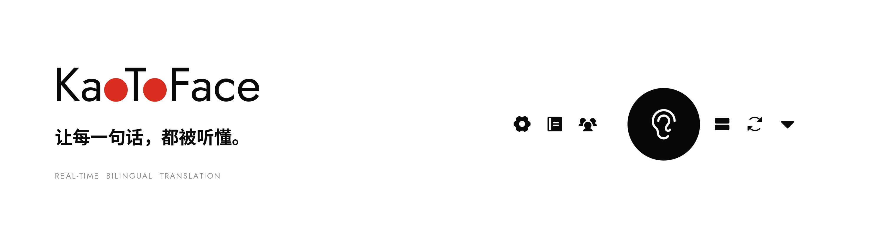

# 颜颜 · KaoToFace

一台 Android 手机，两种语言，面对面实时翻译。

把手机放在两人之间，在设置里选好两侧语言，按下屏幕中央的聆听键。一侧说话，本地 VAD 在句末切出一段完整语音，DeepSeek ASR 识别文字，DeepSeek 再完成校订与翻译；两栏文字以歌词的方式同步滚动，当前句滑向中央、放大加粗。

支持横屏并列、竖屏并列、面对面三种摆放方式，21 种语言的两侧组合，局域网四位暗号房间，以及整场讨论的记录、导出与分享。

当前版本：**0.1.1**（versionCode 11，Android 8.0+）。

---

## 特点

- **两侧语言自由组合**：A / B 两侧各从 21 种语言中选择，默认英语 / 中文；交换键只换位置，不改语言。
- **句末翻译，不是半句猜**：本地能量 VAD 等到一句话说完再上传，避免把半句送去识别。
- **有节奏的等待**：说话时两栏显示弹动灰色方格，数量随说话时长增加；结果回来后文字逐字浮现。
- **歌词式阅读**：两栏共用焦点，滑动任意一栏，另一栏同步到同一句；点句即滑向中央并放大。
- **每次聆听都是一条记录**：按「日期 · 编号」自动保存，可回看、分享、复制或保存为文件。
- **局域网直连**：四位暗号加入同一房间，房主收音，成员同步观看。
- **纯白单色界面**：黑 / 白 / 灰；红色只属于按下后的聆听键。

---

## 快速开始

1. 安装 `KaoToFace-0.1.1.apk`（Android 8.0 及以上）。成品包不提交到 Git，可用 `assembleRelease` 自行构建。
2. 首次启动授予麦克风权限；通知权限用于聆听时的前台服务，拒绝不影响基本使用。
3. 打开设置，填入你自己的 DeepSeek API Key，点「测试连接」确认可用。
4. 在「两侧语言」中选择 A / B。默认是 English 与中文；选到另一侧正在使用的语言会自动对调。
5. 把手机放在两人中间，点中央聆听键开始。说完一句后稍等片刻，双语会一起出现。
6. 想先看效果：设置 →「播放演示对话」，会用内置的中英会议录音完整走一遍 VAD → ASR → 翻译 → 歌词滚动。

> **隐私与网络**
>
> 本地只做能量 VAD 切句和 PCM 预录，不上传连续音频。每句结束后，该句 WAV 会发送到 DeepSeek ASR；识别文字再发送给 DeepSeek 做校订与翻译。
>
> 因此识别和翻译都需要网络，**没有本地离线识别**。API Key 只保存在本机应用私有存储中，仓库和根目录 APK 都不包含任何 Key。

---

## 三种显示模式

| 模式 | 摆放方式 | 阅读方向（默认） |
|---|---|---|
| 横屏并列 | 手机横放，两人在同一侧 | A 在左，B 在右 |
| 竖屏并列 | 手机竖放，两人在同一侧 | A 在上，B 在下 |
| 面对面 | 手机平放桌面，两人在屏幕两侧 | 上下各朝一人，上方内容自动倒转 180° |

A / B 默认对应英语 / 中文；在设置中改语言后，两栏内容随之切换。交换键只交换两侧位置，不改语言。

### 控制条

- 控制条固定在屏幕正中，以聆听键为中心，所有小按钮的间距保持一致。
- 竖屏并列 / 面对面：左侧为设置、记录、房间；右侧为模式、交换、回到最新。
- 横屏并列：控制条竖排，平行屏幕短边；上组从外到内为回到最新、交换、模式，下组从内到外为房间、记录、设置。
- 横屏不是把按钮简单搬到上下，而是把每个按钮按竖屏的物理位置逐一对齐；切换模式时控制条作为整体旋转，按钮不换位。
- 小按钮无胶囊底、统一纯黑，间距 12dp；图标始终保持正向。
- 中央栏收窄，歌词在靠近控制栏的一侧用白色渐变淡出，不切断文字。
- 模式切换用一次白色渐隐遮住布局重排，聆听键始终留在屏幕中央。

### 聆听键

线稿耳朵图标。按下后内部出现缓慢流动的玻璃渐变红点，再按停止；红点由多层错位的柔化深色块叠成，不做外发光、不额外加光点。待机与聆听之间有背景、圆点和耳朵的过渡动画。

---

## 阅读与动画

- 两栏共用同一个焦点索引；滑动任意一栏，另一栏自动滚动到同一句。
- 手动滑动后会暂停自动跟随；点控制条上的「回到最新」恢复跟随。
- 点按任意一句：该句一边滑向中央，一边按比例放大并加粗。滑动与缩放都是 340ms，同时开始、同时结束。
- 每行按同一字号排版，高亮只改变图形缩放与描边，不重排文字，因此不会跳动。
- 竖屏并列时，上方一栏反向排列，旧句留在靠近中央栏的一侧；下方一栏保持自然顺序。
- 长句完整换行，不做 5 行省略号截断，由歌词列表滚动承载。

### 等待与出现

1. 检测到说话，两栏各出现 3 个灰色方格，随说话时长每 350ms 增加一个，最多 8 个。
2. 方格持续做正弦上下弹动和透明度呼吸，表示句子仍在收音。
3. 句末 VAD 静音确认后，音频上传 DeepSeek ASR。
4. 识别和翻译返回，方格消失，源侧与译文侧的文字分别逐字浮现；行高随文字展开，列表自动跟随。
5. 如果识别或翻译失败，保留 ASR 原文并标记「未翻译」，不会整段消失或退回空聆听页。

---

## 翻译流程

```
麦克风 16 kHz 单声道 PCM
        │
        └─ 本地能量 VAD
             预录 700ms · 静音 700ms 断句 · 最短 300ms · 单句最长 20s
             │
             ├─ 说话中：两栏弹动灰色方格
             │
             └─ 句末：PCM 封装 WAV
                       │
                       ▼
                 DeepSeek ASR
                 自动检测语言 · 返回纯文本
                       │
                       ▼
             DeepSeek 校订 / 翻译
             判断属于 A 还是 B · 保留数字金额 · 按语义分句
                       │
                       ▼
              {"src":"a"|"b","lines":[{"a":"…","b":"…"}]}
                       │
                       ▼
        同一句在两侧逐字浮现 → 记录 / 局域网广播
```

- **VAD 只做切句**：不依赖语言模型，不下载语音包；语音起点前的 700ms PCM 会一并保留，因此首字不丢。
- **DeepSeek ASR 是非流式的**：源文本要等句末上传并返回，不会显示不可靠的半句 partial。
- **每句一次 ASR + 一次翻译**：翻译请求串行排队，保证上下文顺序，也避免逐 partial 调用造成费用和抖动。
- **数字与金额**：提示词明确要求保留数字、金额、时间和否定关系；含金额的句子会额外强调。
- **长文本**：DeepSeek 按语义拆成多个完整句子返回 `lines[]`，每句在两侧对齐；界面不截断。
- **失败可见**：ASR 空结果提示「未识别」，翻译失败保留 ASR 原文并标记「未翻译」。

---

## 支持的语言

两侧语言来自 DeepSeek ASR 支持的 21 种语言：

| 代码 | 语言 | 代码 | 语言 | 代码 | 语言 |
|---|---|---|---|---|---|
| `zh` | 中文 | `en` | English | `ja` | 日本語 |
| `ko` | 한국어 | `yue` | 粤语 | `fr` | Français |
| `de` | Deutsch | `es` | Español | `ru` | Русский |
| `pt` | Português | `it` | Italiano | `ar` | العربية |
| `hi` | हिन्दी | `id` | Bahasa Indonesia | `vi` | Tiếng Việt |
| `th` | ไทย | `tr` | Türkçe | `ms` | Bahasa Melayu |
| `fil` | Filipino | `pl` | Polski | `hu` | Magyar |

- ASR 会自动判断这句话属于哪种语言，再翻译到另一侧。
- 点按句子朗读使用手机系统 TTS；是否支持某一语言取决于手机安装的语音包。
- 应用界面的中文、日文、韩文使用思源黑体，拉丁文字使用 Jost，阿拉伯文、天城文、泰文等由系统字体回退显示。

---

## 记录与导出

- **每次按下聆听键都会开始一条独立记录**，默认命名为「日期 · 当日编号」，例如 `2026-11-26 · 01`。
- 新一轮聆听从空记录开始；上一轮自动保存。
- 控制条上的记录图标打开记录页：按时间倒序列出所有记录，显示句数和时间。
- 点开一条记录可查看双语全文，并：
  - 分享 Markdown：逐句对照、时间戳、说话人（多人时）、场次时长；
  - 分享纯文本：任何聊天软件都能直接打开；
  - 复制全文；
  - 保存到下载目录 `Download/BilingualNotes/`。
- App 重开后，主界面显示最近一条**有内容**的记录；空记录只留在记录页。

---

## 局域网房间（四位暗号）

1. 一台手机点控制条上的房间图标 →「创建房间」，得到四位暗号，例如 `8752`。
2. 同一 Wi-Fi 下，其他人打开应用 →「加入房间」→ 输入暗号，即可同步观看同一份双语时间线。
3. 找不到时可展开「手动输入主机 IP」，填入房主手机上显示的 `192.168.x.x`。
4. 房主默认用自己的麦克风收音；在房间页打开「允许成员用手机收音」后，成员也可以用自己的手机发言。
5. 多人同时收音可能重复拾音，建议只开一台设备。

- 局域网直连，不经过任何服务器；房主是权威中继，新成员加入时收到完整时间线快照。
- 房间内容不加密、四位暗号不做身份认证，请在可信 Wi-Fi 下使用。
- 房主结束房间后，成员会看到断开提示。
- 房间只广播完成的句子，不广播本机的方格占位或临时状态。

---

## 设置

点控制条上的齿轮图标进入设置。

| 项目 | 说明 |
|---|---|
| DeepSeek API Key | 首次使用需填写；只保存在本机，仓库源码不含密钥。「测试连接」显示真实往返耗时。 |
| 模型 | 打开设置时从 DeepSeek `/models` 实时读取并显示名称，点选即切换；默认 `deepseek-flash`。 |
| 两侧语言 | A / B 各选一种语言，默认 English / 中文；选到对侧正在使用的语言会自动对调。 |
| 语气 | 自然口语 / 简洁直接 / 商务正式，影响翻译提示词。 |
| API 地址（高级） | 兼容 OpenAI 协议的自定义网关；默认 `https://api.deepseek.com`。 |
| 字号 | 82%–122%，即时预览。 |
| 点按当前句子朗读 | 系统 TTS；朗读时自动暂停收音。 |
| 我的昵称 | 显示在房间成员列表和导出中。 |
| 播放演示对话 | 用内置中英录音走完整流程，不需要麦克风。 |

---

## 技术实现

- **客户端**：Kotlin 2.2、Jetpack Compose、Material 3；`minSdk 26`，`targetSdk 36`。
- **音频**：16 kHz 单声道 PCM16；`AudioCapture` 持续采集，`UtteranceVad` 用自适应能量阈值切句，`WavCodec` 封装 WAV。
- **识别**：`POST https://api.deepseek.com/v1/tools/asr`，multipart 上传 WAV；服务端自动检测语言，单文件上限 120 秒 / 8 MiB，非流式。
- **翻译**：DeepSeek Chat Completions，`response_format=json_object`，`thinking` 关闭；模型返回 `src` 和 `lines[{a,b}]`，客户端映射到 `Utterance.en/zh` 两个槽位。
- **A / B 槽位**：数据层继续使用 `en` 表示 A 侧、`zh` 表示 B 侧；A/B 可以不是英语/中文，真实语言由设置决定。TTS 使用对应语言的 BCP-47 标签。
- **歌词**：两个 `LazyColumn` 共用一个焦点索引；点句立即设焦点，同时启动 340ms 滚动与 340ms 缩放/描边；行高按激活字号固定，缩放走 `graphicsLayer`，不会重排文字。
- **等待动画**：`SkeletonSquares` 按 `createdAt` 计算方格数并做弹动；`revealedChars` 驱动逐字浮现。
- **记录**：`RecordsStore` 把记录写入应用私有目录的 `records.json`，先写临时文件再原子替换。
- **房间**：UDP `19999` 广播/探测发现房间；TCP `30000 + 暗号` 传输 JSON 行；房主负责权威广播。
- **前台服务**：聆听会话使用 `foregroundServiceType=microphone|dataSync` 的通知保活，通知里可直接停止。
- **字体**：Jost 用于所有拉丁字符；思源黑体用于中文、日文、韩文；图标使用 Phosphor Fill。文本按字符分段，中文文案里的英文、URL、数字也走 Jost。

### 目录

```
app/src/main/java/com/kaotoface/app/
  core/     SessionEngine, AudioCapture, UtteranceVad, PcmRingBuffer,
            DeepSeekTranslator, WavCodec, TextSegmenter, Exporter,
            RecordsStore, HistoryStore, TtsPlayer, LanguageCatalog, Settings
  room/     RoomHost, RoomClient, LanDiscovery, RoomWire
  service/  TranslationService（前台服务 + 通知）
  ui/       Lyrics, AppText（按脚本分段字体）, Chrome（固定控制簇）, Sheets, theme
app/src/main/assets/
  demo/conversation.wav
app/src/main/res/font/    Jost + 思源黑体 + Phosphor Fill
app/src/main/res/drawable/ic_ear.xml
docs/      hero 横幅与设计素材
```

---

## 构建

环境：JDK 17+、Android SDK 36、Gradle 8.14.3（wrapper 已带）。

```bash
./gradlew assembleDebug     # 调试包，applicationId 带 .debug 后缀
./gradlew assembleRelease   # 正式包；本地有签名密钥时自动签名
```

构建完成后，把正式包按版本命名放到**项目根目录**，并生成 SHA-256：

```bash
cp app/build/outputs/apk/release/app-release.apk ./KaoToFace-0.1.1.apk
sha256sum KaoToFace-0.1.1.apk > KaoToFace-0.1.1.apk.sha256
```

**版本号规则**：每次发布最后一位 +1，逢十进一（`0.0.2 → 0.0.3 … 0.1.0 → 0.1.1`），`versionCode` 同步 +1。

**签名**：仓库不包含签名密钥与密码。本地构建签名 release 时，把 keystore 放到 `tools/keystore/kaotoface.jks`（已加入 `.gitignore`），并设置环境变量：

```bash
KAOTOFACE_STORE_PASSWORD=...
KAOTOFACE_KEY_PASSWORD=...
KAOTOFACE_KEY_ALIAS=kaotoface   # 可选
```

没有这些变量时，`assembleRelease` 会生成未签名包；`assembleDebug` 不受影响。

**分发约定**：根目录 APK 统一使用 `DEFAULT_API_KEY=""` 构建，可直接分发；构建后检查包内没有 `sk-...` 字符串。APK 与 `.sha256` 不提交到 Git。

`local.properties` 中的 `sdk.dir` 需指向本机 Android SDK。

---

## 已知限制

- **必须联网**：本地只做 VAD 切句，没有本地 ASR，也没有离线回退。
- **句子级延迟**：源文本要等句末静音确认和 DeepSeek ASR 返回；说话过程中只有方格，没有实时 partial。
- **还要等翻译**：ASR 返回后，目标语言需要再等一次 DeepSeek 校订/翻译，不是逐词同传。
- **VAD 是能量阈值**：强噪声、多人同时说话或音量很小时可能切句不准；必要时可替换为 Silero VAD。
- **ASR 限制**：DeepSeek ASR 非流式，单文件上限 120 秒 / 8 MiB；超长语音被 VAD 限制在 20 秒内切分。
- **语言覆盖**：21 种语言来自 DeepSeek ASR；具体识别质量取决于口音、噪声和语种。
- **TTS 取决于系统**：手机没有对应语言的语音包时，朗读会提示不可用。
- **房间无加密**：四位暗号只用于发现，不提供认证或加密，仅适合可信局域网。
- **系统 UI 无法完全隐藏**：顶部下滑仍可呼出系统栏；部分 Android 系统在录音时会显示绿色麦克风隐私标识。
- **系统字体回退**：阿拉伯文、天城文、泰文等非中日常用脚本由系统字体渲染，不受应用字体控制。

---

## 已验证

- 真机 vivo V2309A（Android 16）安装、启动、`adb install -r` 覆盖升级通过。
- 日文 A / 中文 B 组合实测通过：翻译方向、两侧字体与逐字浮现正常。
- 两侧语言选择、自动对调、交换键只换位置通过。
- 弹动灰色方格随说话时长增加；ASR 返回后文字逐字出现。
- 三种显示模式、歌词同步、点句居中、记录生成与回看、Markdown / 纯文本导出通过。
- 局域网四位暗号房间、UDP 发现、成员加入、房主广播、成员收音权限通过。
- 签名 release 包 `com.kaotoface.app` 0.1.1：`versionCode=11`，应用名「颜颜」，包内无 `sk-` 字符串。

---

## 致谢与许可

- [DeepSeek API](https://api.deepseek.com) — ASR、翻译与校订
- [Jost](https://fonts.google.com/specimen/Jost) — SIL Open Font License 1.1
- [思源黑体 / Noto Sans CJK SC](https://github.com/notofonts/noto-cjk) — SIL Open Font License 1.1
- [Phosphor Icons](https://github.com/phosphor-icons/web) — MIT License
- AndroidX、Jetpack Compose、OkHttp — Apache-2.0
- 演示音频由 Windows 内置中英文 TTS（Huihui / Zira）合成，仅用于功能演示

字体与完整许可见 [LICENSES.md](LICENSES.md)。
